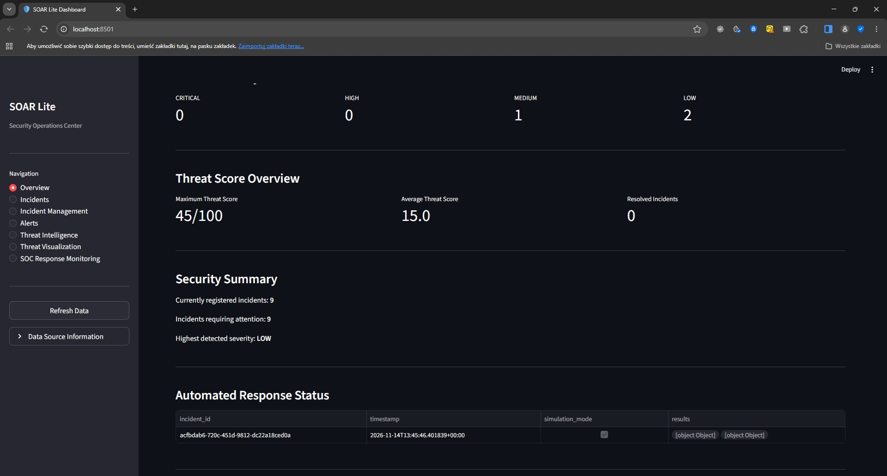
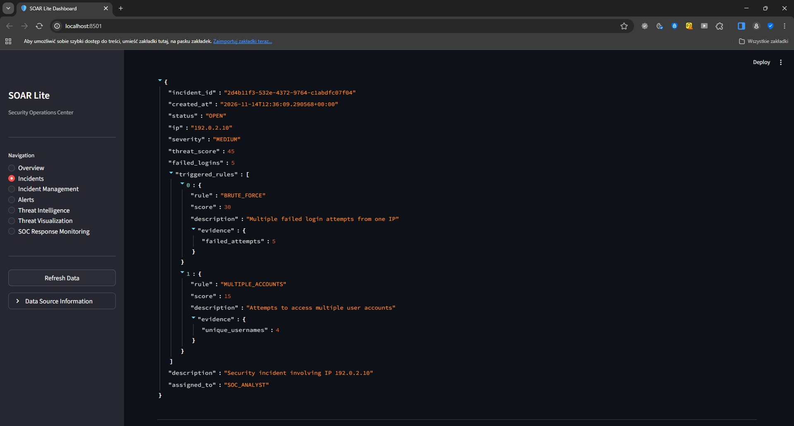
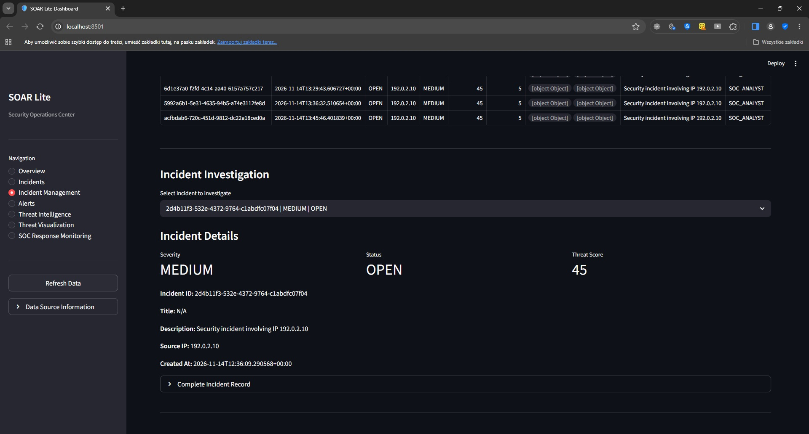
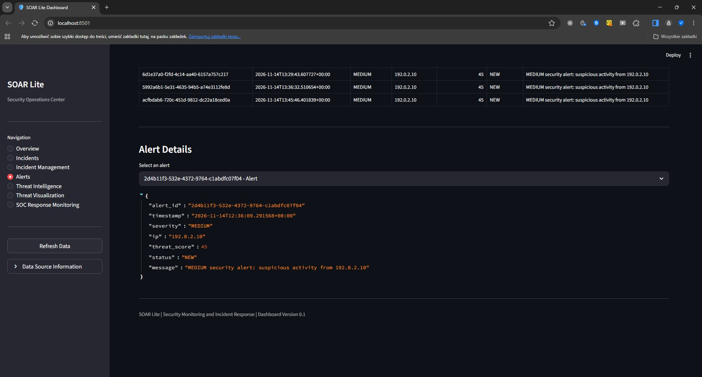
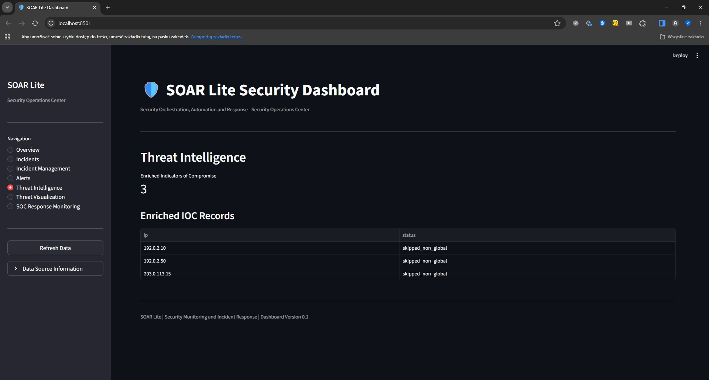
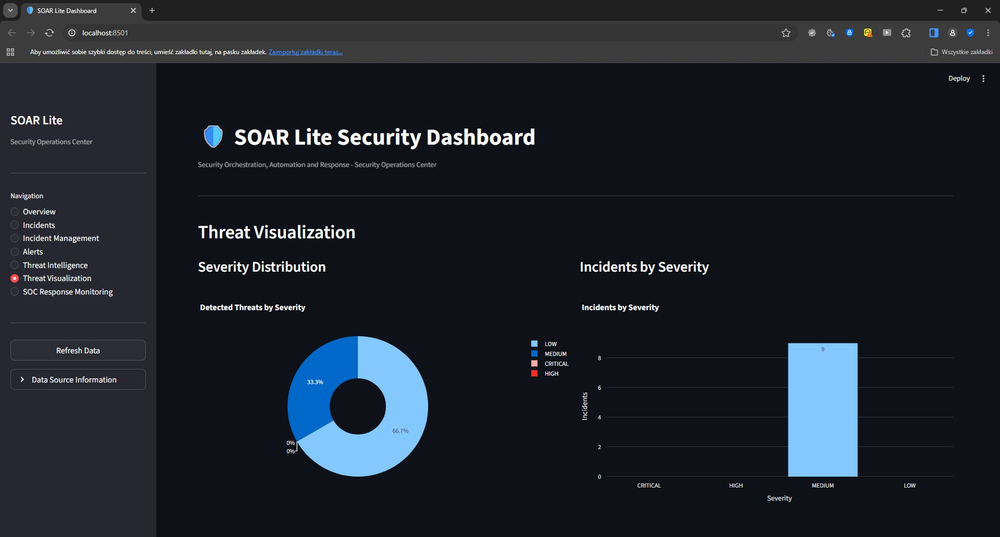
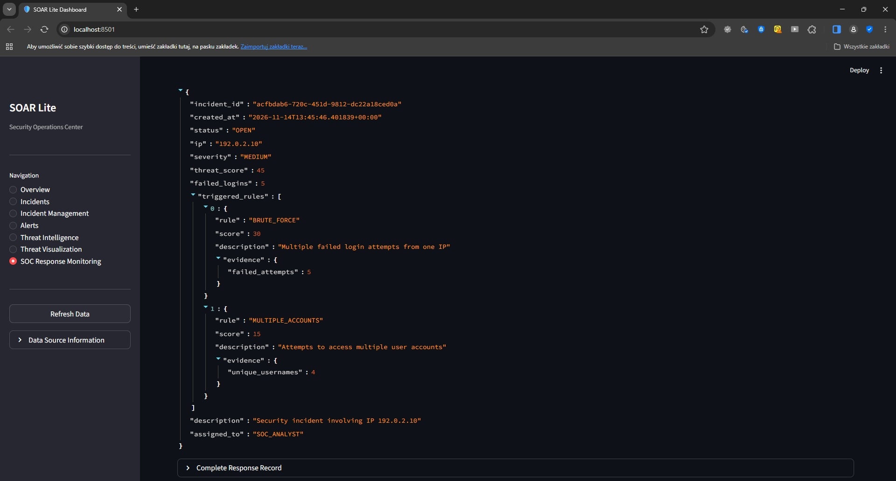

# Security Automation Script (SOAR Lite)

## Overview

A Python-based security automation tool
for log analysis and threat intelligence enrichment.

## Technologies

- Python
- VirusTotal API v3
- AbuseIPDB API v2
- SQLite
- JSON
- YAML

## Features

- Linux and Windows log collection
- IOC extraction
- Threat intelligence analysis
- Threat scoring
- Security alerts
- Incident reporting

## Architecture

Modular Python architecture.

## Installation

```bash
python -m venv .venv
pip install -r requirements.txt
```

## Run

```
python -m src.main
python -m streamlit run dashboard/app
```













